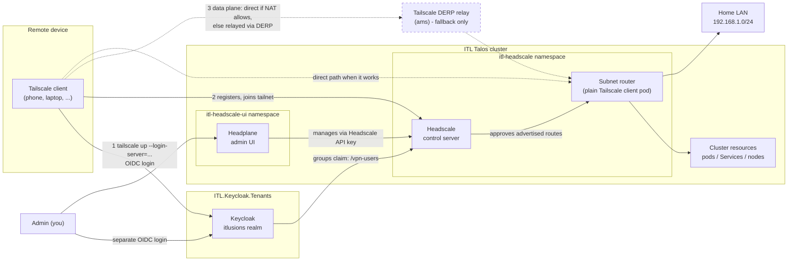

# 1.1 Overview

Self-hosted [Headscale](https://headscale.net/) control server for the ITL Talos cluster - a Tailscale-compatible mesh VPN coordination server, gated by Keycloak OIDC so every device join requires a real login, not a static shared key.

**Live at `https://headscale.itlusions.com` and `.nl`**, confirmed working end-to-end with a real device over both LAN and cellular, 2026-10-24.

## Why this exists

Remote (off-LAN) users need to reach cluster-internal resources and manage the cluster (`kubectl`, `talosctl`) without being physically on the network. The cluster already has an internal-only Traefik instance and various LAN-restricted dashboards (Longhorn, Hubble) - none of that helps someone who isn't on the LAN in the first place. This closes that gap.

## What this replaces

**[`ITL.Wireguard`](https://github.com/ITlusions/ITL.Wireguard)**, not an addition to it. That chart's design: a single gateway pod, static hand-distributed peer `.conf` files, no connection-time authentication, no revocation beyond manually editing a peer list. It worked, but had a structural limitation: WireGuard itself has no concept of login or session - a peer's static key either exists in the config or it doesn't, forever, until someone manually removes it.

Headscale solves this properly: every device join goes through a real Keycloak login, gated by group membership (`/vpn-users`), using a mesh model (Tailscale's actual protocol) instead of a single point-to-point tunnel.

## The three pieces, and why they're separate

| Component | Repo | Role |
|---|---|---|
| Control server | `ITL.Headscale` (this repo) | Coordinates the mesh - who's registered, what routes exist, the ACL policy |
| Admin UI | [`ITL.Headscale.UI`](https://github.com/ITlusions/ITL.Headscale.UI) | Headplane - a web UI over Headscale's own API, separate chart/release/lifecycle |
| Identity provider | [`ITL.Keycloak.Tenants`](https://github.com/ITlusions/ITL.Keycloak.Tenants) | The actual OIDC login flow, realm-wide groups, the `KeycloakOIDCClient` bootstrap automation |

Kept separate deliberately: Headplane's pod restarts (frequent, during active development) don't affect Headscale's own stability, and neither chart needs RBAC into the other's namespace or Keycloak's.

Solid lines are always-on control-plane relationships; dashed lines are the data path, which may go direct or through DERP depending on NAT (see [4.2](../4-operations/4.2-derp-relay-followup.md)).

## Two Keycloak clients, not one

`headscale` (gates `tailscale up --login-server=...` - whether a device can join the tailnet at all) and `headplane` (gates the separate admin-UI login) are two completely independent Keycloak clients, same realm. A leaked secret for one doesn't expose the other.

## What's actually deployed, concretely

- The Headscale server itself (SQLite, file-based ACL policy)
- An in-cluster subnet router (plain Tailscale client, not Headscale) - see [3.1](../3-network/3.1-subnet-router.md) - without this, only the Headscale server itself is reachable, not cluster resources or the LAN
- Dual-domain TLS (`.com` + `.nl`) on the public endpoint
- `/swagger` API docs restricted to internal clients only, same IP-allowlist pattern as Longhorn's UI
